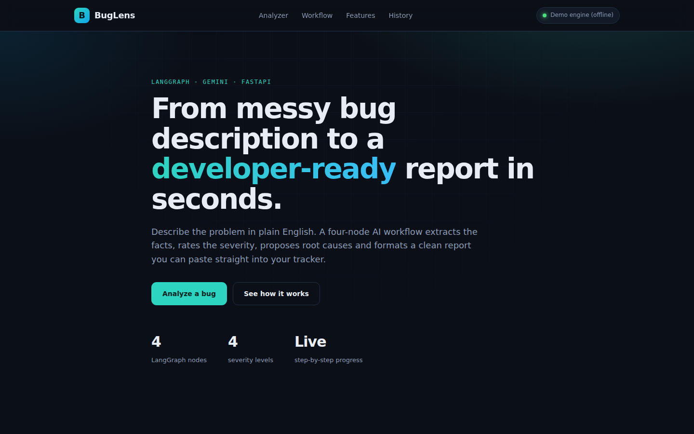
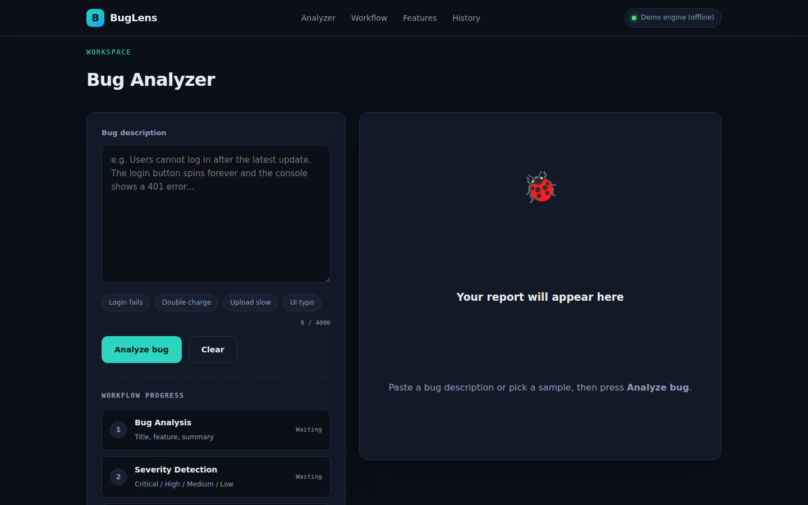
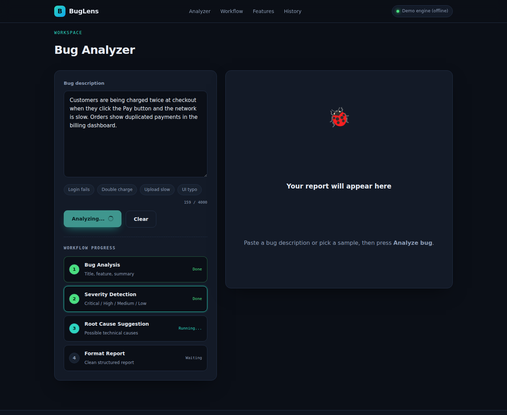
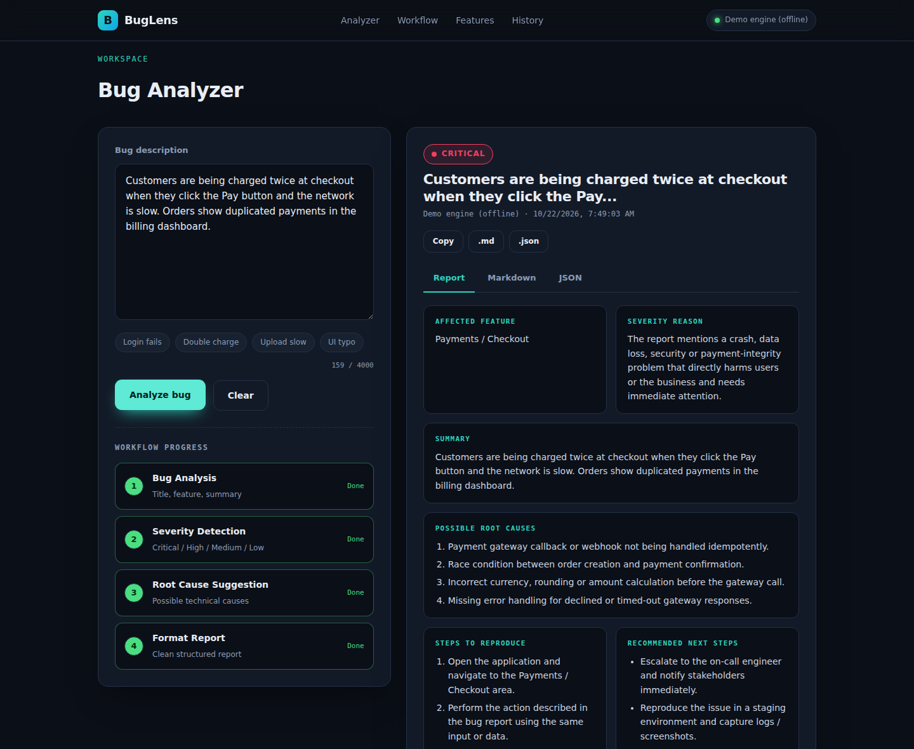
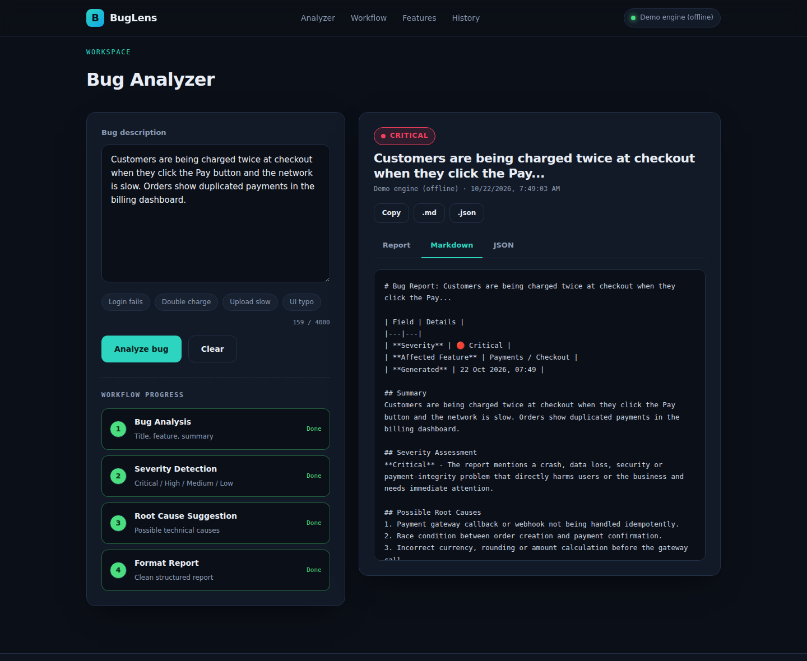
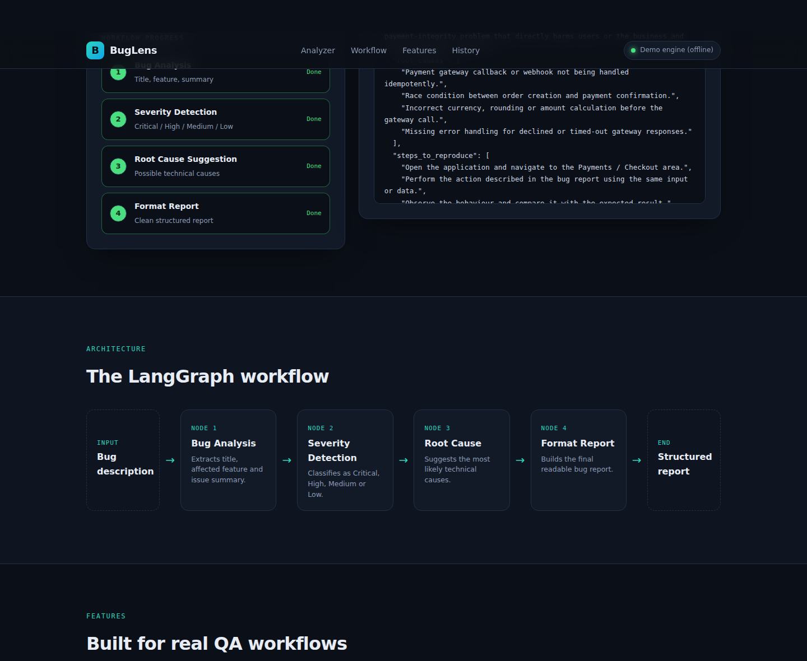
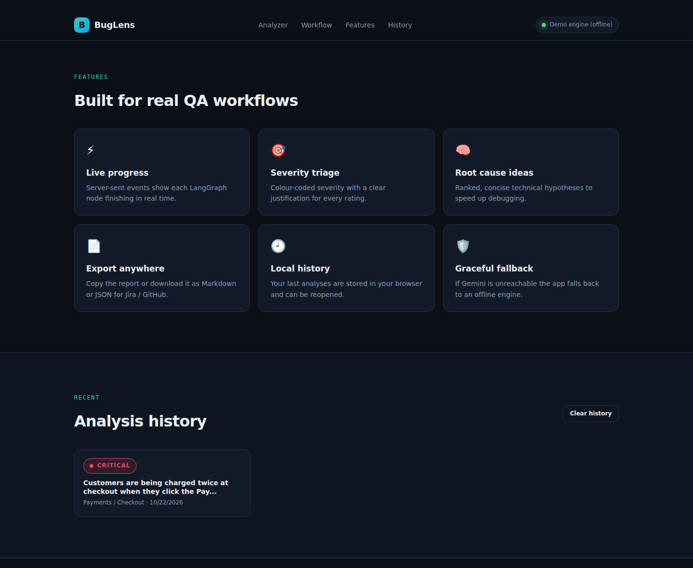
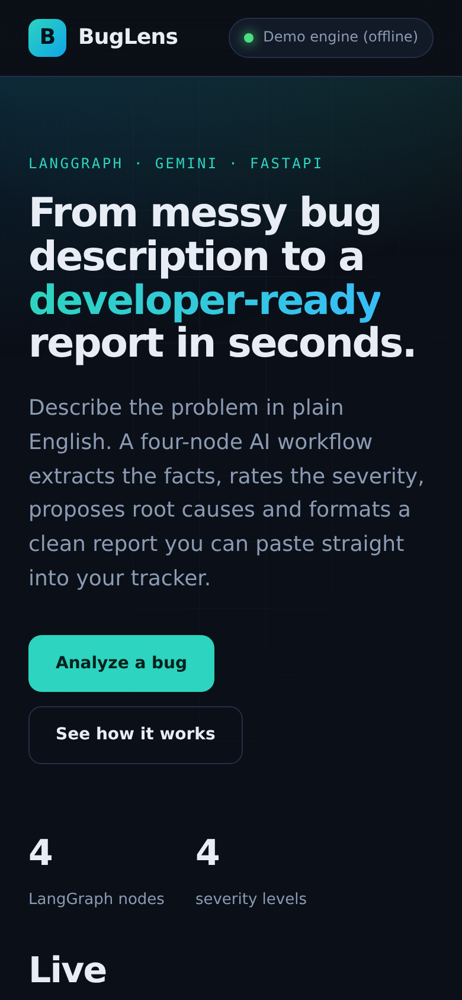

<div align="center">

# 🐞 BugLens - AI Bug Report Analyzer

   🌐 **Live demo:** https://buglens-ayat.web.app  |  **API docs:** https://ai-bug-report-analyzer.vercel.app/docs

**Turn a plain-English bug description into a structured, developer-ready bug report.**
Powered by **LangGraph** · **Google Gemini** · **FastAPI**


</div>

> **SMIT Assignment** - AI & Data Science, Batch 12 · Author: **Anushay Ayat** · Submitted: 22/10/2026



---

## ✨ Overview

The user types a bug description in natural language. A **four-node LangGraph workflow** analyses it step by step and returns a clean, structured report.

```
User Input (bug description)
        ↓
Node 1 - Bug Analysis        → title, affected feature, issue summary
        ↓
Node 2 - Severity Detection  → Critical | High | Medium | Low (+ reason)
        ↓
Node 3 - Root Cause          → 3-5 possible technical causes
        ↓
Node 4 - Format Report       → clean, readable Markdown bug report
        ↓
END → Structured Bug Report
```

## 🚀 Features

- **LangGraph state machine** with 4 nodes sharing a typed `BugState`
- **Gemini structured output** (Pydantic schemas) for reliable, parseable results
- **Live workflow progress** in the UI via Server-Sent Events (one event per node)
- **Colour-coded severity** with a written justification
- Extra report sections: **steps to reproduce** and **recommended next steps**
- **Copy / download** the report as Markdown or JSON
- **History** of recent analyses (stored in the browser)
- **Graceful fallback**: if no API key is set (or Gemini is unreachable) an offline rule-based *demo engine* keeps the app working
- Responsive, dark, professional UI · interactive API docs at `/docs` · automated tests

## 📸 Screenshots

| Analyzer | Live workflow |
|---|---|
|  |  |

| Structured report | Markdown output |
|---|---|
|  |  |

| Architecture section | Features section |
|---|---|
|  |  |

<p align="center"></p>

> ℹ️ Screenshots were captured with the offline demo engine. With a Gemini API key the same UI shows Gemini-generated content.

## 🗂️ Project Structure

```
ai-bug-report-analyzer/
├── backend/
│   ├── app/
│   │   ├── main.py              # FastAPI app, CORS, static frontend
│   │   ├── config.py            # Settings from .env
│   │   ├── schemas.py           # Pydantic models (LLM outputs + API)
│   │   ├── api/
│   │   │   └── routes.py        # /api/health, /samples, /analyze, /analyze/stream
│   │   ├── graph/
│   │   │   ├── state.py         # BugState (TypedDict)
│   │   │   ├── prompts.py       # Prompt templates
│   │   │   ├── nodes.py         # The 4 LangGraph nodes
│   │   │   └── workflow.py      # StateGraph wiring + compile
│   │   └── services/
│   │       ├── llm.py           # Gemini (LangChain) + fallback
│   │       └── demo_engine.py   # Offline rule-based engine
│   ├── index.py                 # Vercel entrypoint
│   ├── vercel.json
│   ├── requirements.txt
│   └── .env.example
├── frontend/
│   ├── index.html
│   ├── css/style.css
│   └── js/app.js
├── firebase.json                # Firebase Hosting config (frontend)
├── DEPLOY.md                    # Vercel + Firebase deployment guide
├── tests/test_workflow.py
├── docs/
│   ├── screenshots/             # UI screenshots (+ take_screenshots.py)
│   ├── report/                  # Project report (DOCX + PDF)
│   ├── presentation/            # Slides (PPTX + PDF)
│   └── build/                   # generator scripts for report & slides
└── README.md
```

## ⚙️ Setup & Run

**1. Clone and enter the project**
```bash
git clone <your-repo-url>
cd ai-bug-report-analyzer/backend
```

**2. Create a virtual environment and install dependencies**
```bash
python -m venv venv
# Windows:  venv\Scripts\activate        macOS/Linux:  source venv/bin/activate
pip install -r requirements.txt
```

**3. Add your Gemini API key** (free at <https://aistudio.google.com/apikey>)
```bash
cp .env.example .env        # Windows: copy .env.example .env
# then edit .env and set GOOGLE_API_KEY=...
```

**4. Start the server**
```bash
uvicorn app.main:app --reload
```
Open **http://127.0.0.1:8000** for the website and **http://127.0.0.1:8000/docs** for the API docs.

> No key? The app still runs in **Demo engine (offline)** mode - the badge in the navbar shows which engine is active.

## 🔌 API

| Method | Endpoint | Description |
|---|---|---|
| GET | `/api/health` | Status, version, active engine |
| GET | `/api/samples` | Sample bug descriptions |
| POST | `/api/analyze` | Run the workflow, return the full report (JSON) |
| POST | `/api/analyze/stream` | Same, but streams one SSE event per node |

```bash
curl -X POST http://127.0.0.1:8000/api/analyze \
  -H "Content-Type: application/json" \
  -d '{"description": "Users cannot log in after the latest update. The login button spins forever."}'
```

## 🌐 Deployment
Backend on **Vercel**, frontend on **Firebase Hosting** - see [DEPLOY.md](DEPLOY.md).

## 🧪 Tests
```bash
cd backend
pytest ../tests -q
```

## 📚 Documentation
- 📄 Report: [`docs/report/AI_Bug_Report_Analyzer_Report.pdf`](docs/report/AI_Bug_Report_Analyzer_Report.pdf)
- 📊 Presentation: [`docs/presentation/AI_Bug_Report_Analyzer_Presentation.pdf`](docs/presentation/AI_Bug_Report_Analyzer_Presentation.pdf)

## 🛠️ Tech Stack
Python · FastAPI · LangGraph · LangChain Google GenAI (Gemini) · Pydantic · HTML / CSS / JavaScript (no framework)

## 👩‍💻 Author
**Anushay Ayat** - AI & Data Science, SMIT (Batch 12)
